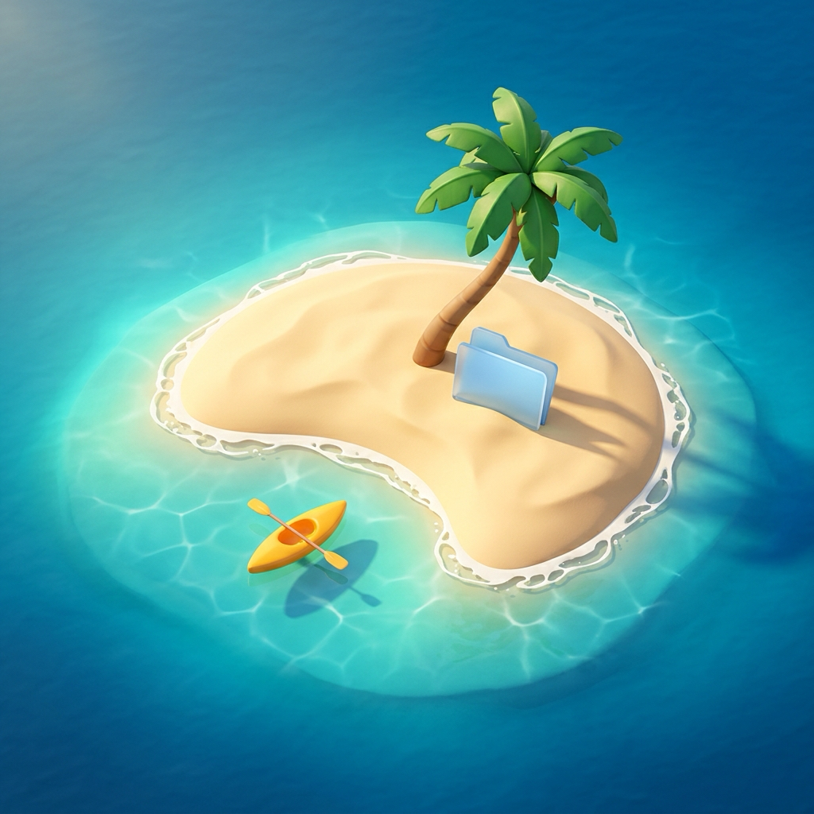
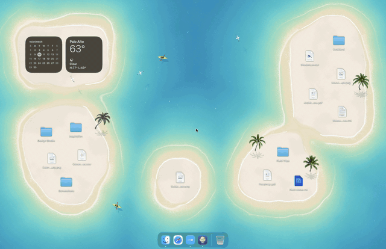
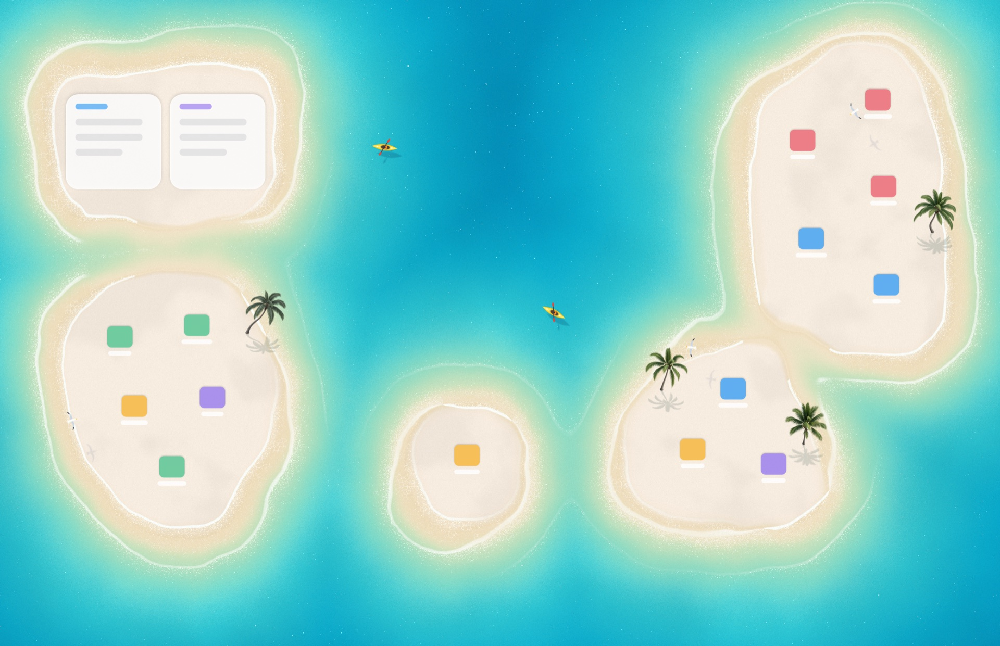
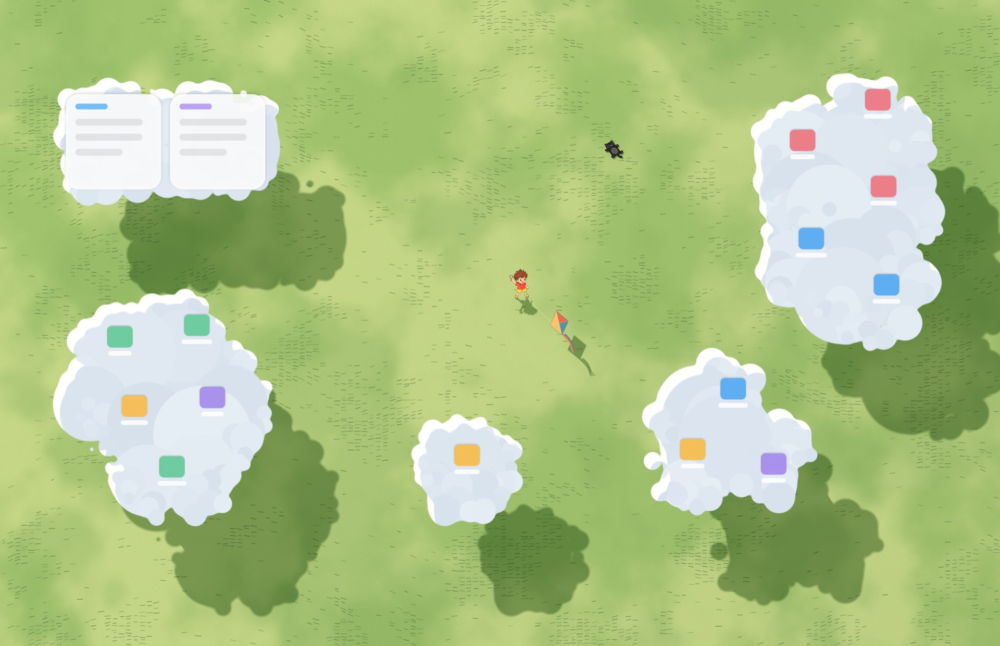
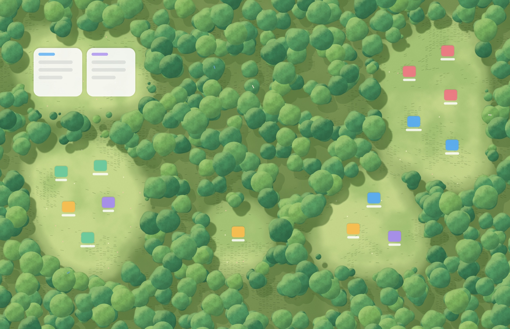
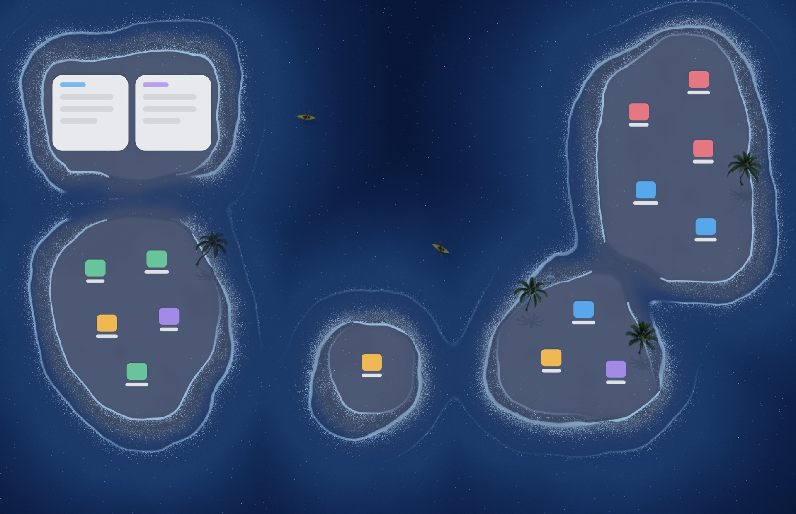

<p align="center">
  
</p>

<h1 align="center">Deskland for macOS</h1>

<p align="center"><b>A native Swift &amp; Metal wallpaper that reacts to your Mac desktop.</b><br>
Islands grow around your icons and widgets. Clouds gather around your files. Forest clearings open wherever you work.</p>

<p align="center">
  <a href="docs/video/deskland-all-themes-preview.mp4"></a>
</p>

> **Credits**
>
> Port of [Deskland](https://github.com/BLEZZ0102/Deskland) by [BLEZZ0102](https://github.com/BLEZZ0102), who created the original concept, scene designs, theme registry, translations, and illustrated artwork. Rebuilt natively for macOS in Swift and Metal. If you enjoy it, please star the [original repository](https://github.com/BLEZZ0102/Deskland).
>
> This is an unofficial, independent build. It is not affiliated with or endorsed by the upstream authors or Hangzhou Lingdong Wanji Technology Co., Ltd. Licensed under [GPL-3.0](LICENSE).

## Desktop icons, widgets & iCloud

Every file, folder, drive, and widget on your Desktop shapes the landscape in real time:

- **120 Hz Interactive Mode (default):** Renders your real Desktop items, so islands, clouds, and clearings reshape at up to 120 Hz as you drag. Supports Finder shortcuts (`Space` Quick Look, `Return` rename, `⌘O` open, `⌘⌫` Trash, `⌘D` duplicate, `⇧⌘N` new folder, `⌘C`/`⌘V`), drag-and-drop to and from apps and the Dock, Snap to Grid, and Clean Up By.
- **Finder Underlay Mode:** Keeps Finder's native icons. Deskland runs behind them and reads `.DS_Store` icon positions with zero special permissions, following icon drags live.
- **macOS Desktop Widgets:** Detects Notification Center Desktop Widgets, so islands, clouds, and clearings form around your widgets and morph when you move them. Icon placement stays clear of widget bounds.
- **iCloud Desktop:** Detects *Desktop & Documents in iCloud Drive*, cloud placeholders, and on-demand downloads.
- **Theme Folder Compatible:** Load an upstream Deskland wallpaper folder (`themes.json` + `.html`) alongside the built-in Metal scenes, or share anonymized Privacy Snapshots.

## Light on your battery

Deskland is a ~1 MB native Metal binary that uses ~64 MB of RAM and renders only while the desktop is visible:

| Desktop state | Frame rate |
| --- | --- |
| Dragging icons, morphing terrain, water ripples | Up to 120 Hz (ProMotion) |
| Desktop visible & calm | 24 / 30 / 60 Hz (configurable) |
| Covered by app windows, full-screen app, display asleep, or locked | 0 Hz (paused, 0% CPU & GPU) |

## Scenes & time of day

<table>
  <tr>
    <td width="33%"></td>
    <td width="33%"></td>
    <td width="33%"></td>
  </tr>
  <tr>
    <td><b>Beach</b><br>Sand islands and atolls form around icons and widgets, with breaking surf, paddling kayaks, gliding gulls, and swaying palms.</td>
    <td><b>Meadow</b><br>Clouds drift across a gouache meadow and gather around your files while a boy flies his kite and a black kitten naps nearby.</td>
    <td><b>Forest</b><br>Wind-swayed treetops open into sunlit clearings around your work, with songbirds by day and fireflies at night.</td>
  </tr>
</table>

Colors shift across the day, from rose-gold dawn and turquoise daylight to coral-orange sunset and moonlit night. Sync them to your Mac's clock, pin them to a preset, or scrub across 24 hours in Liquid Glass Settings.



## Download

Download the signed and notarized app from the [latest release](https://github.com/willi/deskland-macos/releases/latest). It runs on Apple Silicon Macs with macOS 27. Unzip it and move Deskland to your Applications folder.

## Build from source

Requires macOS 27 and Xcode / Swift 6.2+.

```zsh
git clone https://github.com/willi/deskland-macos.git
cd deskland-macos
./Scripts/build-app.sh
open build/Deskland.app
```

## License

Released under [GPL-3.0](LICENSE), same as upstream [BLEZZ0102/Deskland](https://github.com/BLEZZ0102/Deskland). See [`NOTICE.md`](NOTICE.md) for attribution and trademark details.
